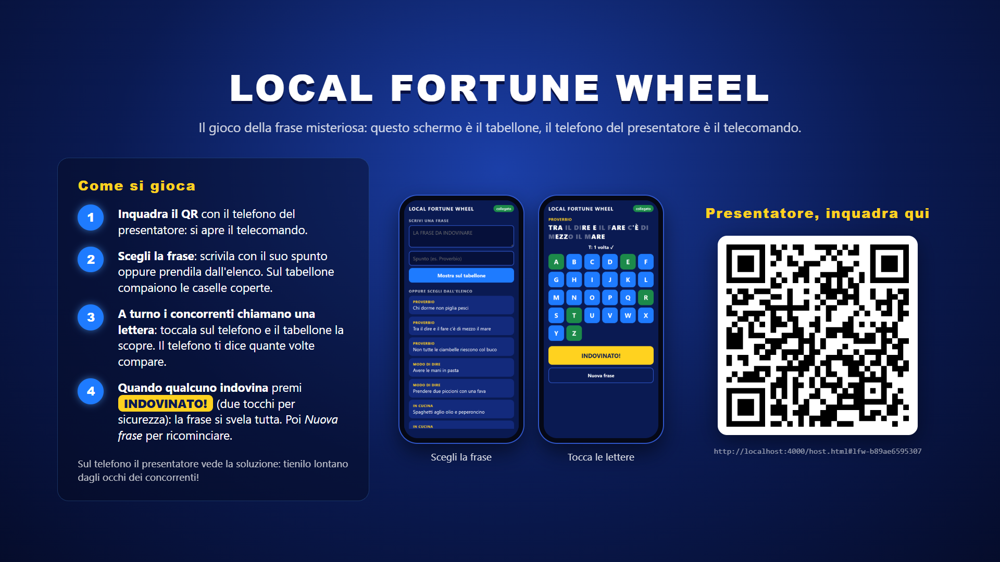
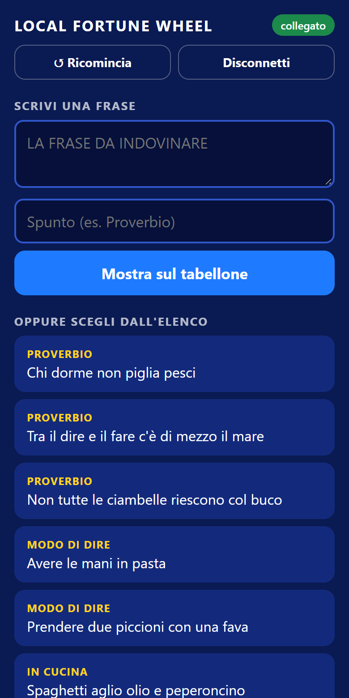
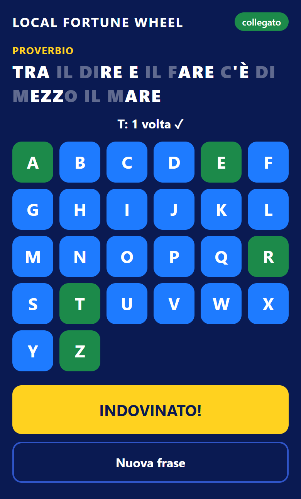
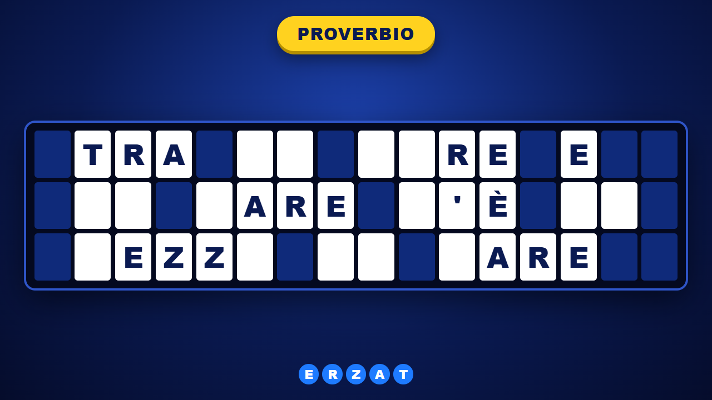

# Local Fortune Wheel

Il gioco della frase misteriosa da fare in compagnia: lo schermo del PC (o la TV) è il **tabellone**, il telefono del presentatore è il **telecomando**.

**Gioca subito:** <https://toxin95.github.io/LocalFortuneWheel/>

## Come si gioca

1. Apri il gioco sul PC collegato allo schermo (F11 per lo schermo intero)
2. Il **presentatore** inquadra il QR con il telefono: si apre il telecomando
3. Il presentatore **sceglie la frase**: la scrive con il suo spunto oppure la prende dall'elenco. Sul tabellone compaiono le caselle coperte
4. A turno i **concorrenti chiamano una lettera**: il presentatore la tocca sul telefono e il tabellone la scopre. Il telefono dice quante volte compare
5. Quando qualcuno indovina, il presentatore preme **INDOVINATO!** (due tocchi per sicurezza) e la frase si svela tutta. Con **Nuova frase** si ricomincia

| Telefono: scegli la frase | Telefono: tocca le lettere | Tabellone |
| --- | --- | --- |
|  |  |  |

Il presentatore vede la soluzione sul telefono: meglio tenerlo lontano dagli occhi dei concorrenti!

Se il telefono si scollega durante la partita, in basso a sinistra sul tabellone compare un piccolo QR per ricollegarsi. Per azzerare tutto dal PC c'è il tasto **↺ Ricomincia** in basso a destra (due clic per conferma).

## Due modalità

| | Online (GitHub Pages) | LAN (`node server.js`) |
| --- | --- | --- |
| Cosa serve | Solo un browser | Node.js 18+ sul PC |
| Internet | Sì, su PC e telefono | No, basta la stessa rete Wi-Fi |
| Telefono | Qualsiasi rete, anche dati mobili | Stessa rete del PC |

### Online (GitHub Pages)

Apri <https://toxin95.github.io/LocalFortuneWheel/> sul PC e segui le istruzioni a schermo.

Telefono e tabellone si collegano direttamente tra loro (WebRTC, con la libreria [PeerJS](https://peerjs.com/)). La partita è tenuta dal tabellone: se ricarichi la pagina riprende da dove era e il QR resta lo stesso.

Il sito viene pubblicato automaticamente a ogni push su `main` dalla GitHub Action in `.github/workflows/pages.yml`.

Se il telefono non si collega: controlla che PC e telefono abbiano internet. Alcune reti aziendali bloccano i collegamenti diretti: in quel caso usa la modalità LAN.

### LAN (senza internet)

1. Apri un terminale in questa cartella e lancia `node server.js` (nessun `npm install`)
2. Sul PC collegato allo schermo apri `http://localhost:3000`
3. Il presentatore inquadra il QR con il telefono (stessa rete Wi-Fi del PC)

Se il telefono non si collega:

- Windows Firewall: alla prima esecuzione consenti a Node.js l'accesso alle reti private
- Il QR usa da solo la scheda con cui il PC è collegato alla rete (Wi-Fi o cavo) e si aggiorna se il PC cambia rete, anche a server acceso
- Se il PC ha più indirizzi (cavo, VPN, hotspot...) e il QR punta a quello sbagliato, sul tabellone clicca **Cambia indirizzo** finché il telefono si collega: la scelta viene ricordata
- Per forzare un indirizzo: `set HOST_IP=192.168.x.x` e poi `node server.js`
- Porta diversa: `set PORT=8080`

## Frasi

Le frasi dell'elenco stanno in `public/frasi.json` (`spunto` + `frase`).

- Modalità LAN: puoi modificarlo anche a server acceso
- Modalità online: dopo la modifica fai commit e push, il sito si aggiorna in un minuto circa

## File

- `public/index.html`: tabellone (con le istruzioni nella schermata iniziale)
- `public/host.html`: telecomando del presentatore
- `public/game.js`: regole del gioco (usate sia dal tabellone online sia da `server.js`)
- `public/frasi.json`: elenco delle frasi
- `public/img/`: screenshot del telecomando mostrati nella schermata iniziale
- `public/vendor/qrcode.js`: libreria QR (qrcode-generator, licenza MIT)
- `server.js`: server della modalità LAN
- `docs/`: immagini per questo README
- `.github/workflows/pages.yml`: pubblicazione su GitHub Pages
